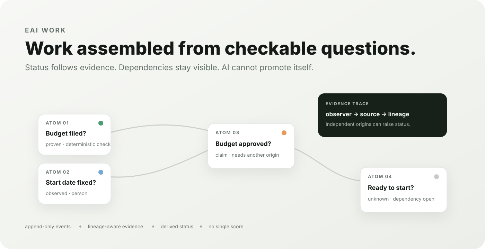
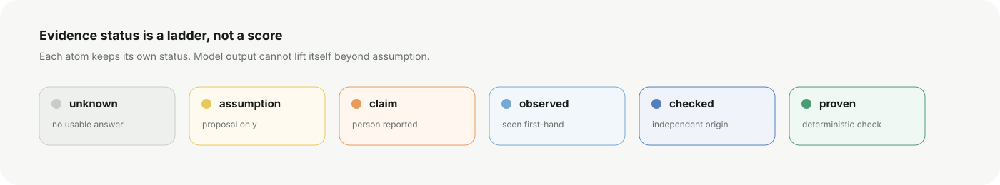

<p align="center">
  
</p>

# EAI work

**Split work into the smallest checkable questions. Keep evidence and its origin visible. Derive status instead of editing it.**

EAI work is an evidence-first workbench. AI may propose an answer, flag a problem or lower confidence. It may not raise the status of its own output. Stronger status comes from person-attached evidence, independent origins or deterministic non-LLM checks.


## What it looks like

The browser workbench is built around the parts that matter during review:

- a **work graph** grouped by cluster;
- a visible **status distribution**, never one aggregate score;
- **dependency markers** on each atomic question;
- a separate **evidence inspector** with observer, registered source, validity, the rule and evidence that carry the status, and what the next status needs;
- **actions in place**: give an answer and attach evidence from the inspector, within the token's write scope;
- a **review queue** for rule flags, weak prerequisites, coverage prompts, model proposals that need a person or are outdated, checks that need a re-run and lowered confidence;
- an **append-only log integrity** indicator.

<p align="center">
  
</p>

## The model

Every job is described as a pack of **atoms**. An atom is one question with one typed answer. `unknown` is always valid.

Status follows this ladder:

`unknown → assumption → claim → observed → checked → proven`

The transition is asymmetric, and every step up needs a footing that can be pointed at. Nothing is granted by count alone.

| Status | What carries it |
|---|---|
| `assumption` | An answer with no counted support. A model answer starts here and a model can never lift it. |
| `claim` | Supporting evidence that is reported, not seen first-hand. |
| `observed` | At least one first-hand supporting item. |
| `checked` | A first-hand item corroborated by an independent second item. |
| `proven` | A deterministic, server-registered check that is grounded. |

**Independent** means the two items share no link: a different registered source *and* a different observer. Two people who looked at the same form are one origin. One person who looked at two documents is one observer. Evidence that cites no registered source still supports an answer, but it cannot corroborate anything, because nothing ties it to a distinct origin.

**Grounded** means the check shows what it stands on. A check proves on its own when it consulted a registered source, or when every other atom it read is itself first-hand or stronger. A check that only re-reads the answer it is attached to restates that answer and is not counted, unless independent evidence stands beside it. The server records the values a check read; when one of them changes, the check stops supporting until it is re-run. This is how the system earns more trust without a person in every loop: its proofs are reproducible and they expire with their inputs.

Contradicting evidence caps an atom at `claim`. Each derived status reports the rule that produced it, the evidence that carries it and what the next status would need. Status is recalculated from the event log and current evidence each time.

A model cannot raise status, but its work is not a black box. Every worker proposal records what the model was given: the registered sources, the input values and a hash of the exact capsule. A proposal whose inputs have since changed is listed as outdated. An unevidenced model proposal on a high-impact atom, with `unknown` winning or with a low self-reported probability is listed as **needs a person**. These are review signals: they never change status, and the probability itself is never shown as a score.

In the HTTP server, evidence origin is assigned by the server: from the registered source a person or system cites, or from the actor identity when none is cited. A client cannot create extra independent origins by changing a lineage string, and cannot cite a source that only feeds atoms it may not read. `check.passed` is server-generated only.

Every token maps to a principal with explicit `read`, `write`, `checks`, `workers` and optional `audit` permissions. Access is default-deny. State, explanations, dependencies, rule output, checksums and review data are filtered to the atoms that principal may read. Deterministic checks declare their own `reads` set; a caller must be allowed to read every declared input, and the check receives only that scoped state.

Model workers are isolated differently from ordinary API principals. A pack declares each worker's allowed dependency values, opaque source handles and context limits. The server builds an `AtomCapsule` containing its local question, optional typed claim-verification contract, choices and bounded authorized inputs. The model never receives the atom id, pack, cluster, sibling atoms, status, evidence, lineage, project goal or caller-supplied context. Public API tokens may not represent model actors, and every atom execution opens a fresh single-use model session. The worker scheduler can be execute-only: no state read, no normal event writes and a bodyless 204 response that does not reveal the model result or whether that result was accepted into state. See [docs/worker-isolation.md](docs/worker-isolation.md) and [docs/atomic-claim-contract.md](docs/atomic-claim-contract.md).

**Model freedom, bounded authority:** provider choice and reasoning ability are separate from evidence promotion. Optional, richer model adapters may suggest exact passages from the atom's local context; an independent, read-only observer checks that those passages exist, **not** that they prove the claim. Strong models are not required to use UMDT/SSL or a citation heuristic. Default model outputs, response routes, actor permissions and append-only evidence/status rules remain unchanged. See [Model-capability-neutral design](docs/model-capability-neutral.md).

## System shape

```text
pack.json
   │
   ├── atoms + dependencies + rules
   │
   ▼
append-only event log ──► replay ──► derived atom state
        ▲                              │
        │                              ├── distributions
person / worker capsule / check        ├── review signals
                                       └── evidence inspector
```

The core package has no network access. The server owns actor identity, event ids and time. Attempts to bypass status rules are rejected and stay observable through the event flow.

## EAIwork lokaal met Ollama

EAIwork kan een **lokaal Ollama-model** gebruiken om een conceptwerkplan voor te stellen. De gewone taakuitvoering en controle blijven bij EAIwork. Het model krijgt geen extra rechten.

1. Installeer Node.js 22.18+ en [Ollama](https://ollama.com/). Start Ollama en download minstens één model, bijvoorbeeld `ollama pull qwen2.5:1.5b`.
2. Start met `npm run local:ollama -- --model=qwen2.5:1.5b`. Bij precies één lokaal model is `npm run local:ollama` genoeg.
3. Open het getoonde localhost-adres, kies **Meer > Contracten en registratie** en verbind met het tijdelijke token dat in je eigen terminal verschijnt.
4. Kies **Uitvoering**, beschrijf de opdracht en vraag een voorstel van het lokale model. Controleer de taken, beperkingen en ontbrekende informatie zelf voordat je ze goedkeurt.

Geen cloudmodel, externe API-sleutel of installatie van een browser-LLM nodig. Het modelendpoint is uitsluitend een lokaal loopback-adres en het programma publiceert niets. Een Ollama-model kan onjuiste of niet-uitvoerbare taken voorstellen. Niet-ondersteunde taken worden door de server geblokkeerd; een planvoorstel is geen bewijs van zelfstandig uitgevoerde softwareontwikkeling.

**Lokale opslag:** `npm run local:ollama` bewaart het operationslog en ondertekeningssleutels standaard in `~/.eaiwork/local`. Na herstart lees je dezelfde opdrachten terug. Er zijn nog geen automatische back-ups. Een beschadigd log wordt niet stilzwijgend gereset. Zie [Ollama lokaal starten](docs/local-ollama-first-run.md).

**Herstel na een onderbreking:** na een herstart laat **Meer > Codeworker > Onderbroken acties** zien of een eerder goedgekeurde bestandswijziging op schijf is terug te vinden. EAIwork blokkeert nieuwe codewijzigingen totdat je de status hebt gecontroleerd. Onbekende bestandsinhoud wordt niet automatisch overschreven. Zie [de herstelprocedure](docs/local-ollama-first-run.md#onderbroken-bestandswijzigingen-controleren).

**Codeworker (afgeschermde proef):** geef een bestaande lokale projectmap vrij met `npm run local:ollama -- --model=qwen2.5:1.5b --worktree=/pad/naar/project`. Onder **Meer > Codeworker** kun je voor één bestaand bronbestand een volledige vervanging laten voorstellen. Pas na het bekijken van de code en een afzonderlijke bevestiging kan EAIwork die ene wijziging toepassen. De oorspronkelijke inhoud wordt bewaard. Er is nog geen automatische testuitvoering, git-commit of algemene autonome codeproductie.

**Optionele echte JavaScript-tests:** installeer Docker en voer vooraf `docker pull node:22-alpine` uit. Kies bij een voorstel een bestaand `.test.js`-bestand. Met **Test in Docker** draait alleen de tijdelijke kopie van de voorgestelde JavaScript-bron en het gekozen testbestand in een afgeschermde container. Een mislukte test blokkeert het toepassen. Dit is geen projectbrede test of volledig beveiligingsonderzoek. Zie de [lokale handleiding](docs/local-ollama-first-run.md).

## EAIwork-dashboard lokaal uitproberen

De nieuwe operationsomgeving staat voorlopig in [concept-PR #23](https://github.com/E-AI-MODEL/EAIwork-/pull/23). Je kunt een afgeschermde, tijdelijke proef starten zonder eerst tokens en een witnessbestand aan te maken:

```bash
npm run demo:dashboard
```

Open het adres dat in de terminal verschijnt, normaal `http://127.0.0.1:8788/dashboard`. Kies **Contracten en registratie**, vul het tijdelijke token uit diezelfde terminal in en verbind de server. Er zijn vier toegelaten lokale workers, vier echte voorbeeldmissies en een eerdere uitvoering beschikbaar. Via **Echte uitvoering**, **Planner en taken**, **Workerleger**, **Bewijs en herkomst**, **Bronnen en RepoSearch** en **Logboek** kun je het verloop onderzoeken. De lokale proef biedt geen algemene autonome AI-agent of online workerhost.

De missie **Automatische tekstverwerking uitproberen** laat twee lokale tekstworkers zelfstandig achter elkaar uitvoeren. Kies bij **Echte uitvoering** een taakmaximum van twee, geef expliciet toestemming en volg het resultaat. Na een serverherstart vervalt de automatische toestemming standaard. Een missie-eigenaar kan via de API vooraf expliciet instemmen met voortzetting van nog niet begonnen lokale taken en met begrensd herstel van bijwerkingsvrije berekeningen. Een onderbroken externe actie wordt nooit automatisch herhaald. Dit is nog geen duurzame, parallelle AI-workerpool.

Deze proef draait uitsluitend op `127.0.0.1`, bewaart gegevens in een tijdelijke map en verwijdert die na normaal afsluiten met Ctrl+C. Gebruik alleen niet-vertrouwelijke voorbeeldinformatie. De publieke HTML-demo op eaimodel.nl bevat geen toegang tot deze lokale server en doet geen modelaanroepen.


De ontwikkelbranches voegen ook revisies van missieplannen en een alleen-lezen plancontrole toe. De beveiligde route `POST /ops/plans/preflight` toont fases, afhankelijkheden en eventuele blokkades voordat een persoon een plan goedkeurt. Zie [de controle van het missieplan](docs/plan-preflight-v0.1.md), [duurzaam herstel](docs/durable-execution-v0.2.md) en [planversies](docs/plan-extensions-v0.1.md). Deze functies staan nog in concept-PR's en zijn geen online productieomgeving.

Een aanvullende, beperkte proef kan twee onafhankelijke lokale teksttaken in afzonderlijke childprocessen uitvoeren via `POST /ops/missions/:id/parallel/run`. Dit is een door een persoon gestarte route, geen automatische parallelle workerpool. De bestaande bewijsregels en herstelbeperkingen blijven gelden. Zie [parallelle uitvoering van vaste tekstworkers](docs/parallel-pure-local-v0.1.md).

Een tweede uitvoeringsproef verbindt een los tekstworkerproces via een beperkt localhost-HTTP-protocol. De missie-eigenaar keurt een taakmaximum goed; de server registreert de claim vóór uitvoering en controleert het resultaat opnieuw. De worker krijgt een apart token zonder toegang tot beheer- of bewijsgegevens. Zie [tekstworker via localhost](docs/local-executor-channel-v0.1.md). Dit is geen gedeelde workerpool over meerdere machines.

Een afgeronde missie kan nu ook een **opleverdossier** krijgen met exacte commit, artifacthash en aangeleverde testverwijzingen. Een andere persoon beoordeelt dat voorstel. De server controleert de externe gegevens nog niet zelfstandig; vrijgave en publicatie blijven uitgeschakeld. Zie [opleverdossier en beoordeling](docs/release-dossier-v0.1.md). De server kan op expliciet verzoek ook de opgegeven GitHub Actions-run bij GitHub vergelijken met de vastgelegde commit. Dat bevestigt alleen de CI-run, niet de inhoud van het kandidaatbestand of toestemming tot publicatie. Zie [GitHub CI-controle](docs/github-ci-verification-v0.1.md). De gebruiker kan vervolgens ook een lokaal kandidaatbestand laten vergelijken met de opgegeven SHA-256. De bytes worden niet uitgevoerd of in het log bewaard. Een match bewijst nog niet dat het bestand uit de GitHub-run komt. Zie [controle van kandidaatbestanden](docs/local-artifact-byte-check-v0.1.md). Een extra controle kan een ZIP-artifact rechtstreeks bij de bevestigde GitHub Actions-run ophalen en één gekozen bestand daaruit met de SHA-256 van de kandidaat vergelijken. De download is begrensd en weigert onveilige ZIP-inhoud. Dit bevestigt de koppeling aan de GitHub-run, niet dat de workflow het bestand reproduceerbaar heeft gebouwd. Zie [GitHub-run-artifacts controleren](docs/github-actions-artifact-v0.1.md). Een [echte GitHub-artifactproef](docs/github-artifact-real-proof-2026-11-10.md) heeft op een aparte ontwikkelbranch een gebouwde JavaScript-module via de EAIwork-server opnieuw opgehaald en geverifieerd. De proef gaf geen vrijgave- of publicatierechten.

Zie [de actuele stand van de uitvoeringsproef](docs/mission-execution-v0.1.md) en [het volledige bouwplan](docs/buildplan-eaiwork-2026-11-10.md). Het oorspronkelijke bewijsgericht werken hieronder blijft van toepassing.

## Quickstart

Requires Node `22.18+`. No runtime dependencies are required.

```bash
npm test
npm run lint:pack
npm run replay:demo
cp tokens.example.json tokens.json
# Replace every REPLACE_... key with a random secret, for example:
# openssl rand -hex 32

openssl genpkey -algorithm Ed25519 -out witness-private.pem
openssl pkey -in witness-private.pem -pubout -out witness-public.pem
mkdir -p ../eai-witness

EAI_TOKENS=tokens.json \
EAI_WITNESS_DIR=../eai-witness \
EAI_WITNESS_PRIVATE_KEY=./witness-private.pem \
EAI_WITNESS_PUBLIC_KEY=./witness-public.pem \
npm run serve
```

Open `http://127.0.0.1:8787`. The server requires an explicit `EAI_TOKENS` file, rejects placeholder/example tokens and binds to `127.0.0.1` by default. It also requires an Ed25519-signed, cryptographically chained witness journal outside `EAI_DIR`. Put that witness directory on a separate mounted volume or other rollback-resistant storage in deployments where datastore rollback must remain detectable. Keep the private key in a secret store or protected mount. Set `EAI_HOST` only when you deliberately want to expose the service on another interface.

Existing deployments with non-empty logs need one explicit trust-on-first-use step before first start with this version:

```bash
eai verify-local ./data
eai bootstrap-witness ./data ../eai-witness ./witness-private.pem ./witness-public.pem
eai verify-log ./data ../eai-witness ./witness-public.pem
```

Only bootstrap a log whose local chain and current head you already trust. After bootstrap, use `verify-log` for full verification; `verify-local` checks only the datastore itself.

The HTTP write path uses a cached verified head and file fingerprints, so normal writes and rejected requests do not rescan the full event or witness history. Startup, `verify-log` and audit verification still perform a full chain check. Any external change to tracked log/head/witness files invalidates the fast path and forces full verification.

The server also takes an exclusive writer lock for the lifetime of the process. `EAI_DIR` is forced to mode `0700` and tracked files to `0600`; the witness directory is also `0700`. Run EAIwork under a dedicated OS account and do not grant other processes direct write access to `EAI_DIR`. Supported writes are serialized through the Store.

Useful CLI commands:

```text
eai lint-pack <pack.json>
eai replay <pack.json> <events.jsonl>
eai explain <pack.json> <events.jsonl> <atom>
eai report <pack.json> <events.jsonl> [goal-atom,...]
eai agree <answersA.json> <answersB.json>
eai verify-local <data-dir>
eai verify-log <data-dir> <witness-dir> <public-key.pem>
eai bootstrap-witness <data-dir> <witness-dir> <private-key.pem> <public-key.pem>
```

## Repository map

| Path | Purpose |
|---|---|
| `packages/core` | Derivation, validation, replay, rules, analysis, agreement and calibration. No network. |
| `packages/server` | Token-derived identity, hash-chained event storage and HTTP API. |
| `packages/client` | Dependency-free evidence-first workbench. |
| `packages/gateway` | AtomCapsule builder, local-only Ollama provider, mock adapter and optional citation proposals. |
| `packages/evidence` | Pure source-reference integrity observer. No semantic proof or status writer. |
| `packages/cli` | Pack linting, replay, explanation, reports, agreement and log verification. |
| `schema/v0.1` | Draft JSON Schema. Not yet enforced in code. |
| `conformance` | Behavioral vectors any compatible implementation should pass. |
| `packs` | Example packs. Current data is invented demo data. |
| `evidence` | Research bibliography with a source type for every claim. |
| `proposals` | Design proposals. |
| `docs` | Architecture and interface notes. |

## Guarantees in v0.1

- **Derived status:** no actor edits status directly.
- **Model asymmetry:** models may not raise status or impersonate a person.
- **Server-controlled independence:** public clients cannot mint extra evidence origins; origin comes from a registered source or, failing that, from the actor identity and then cannot corroborate.
- **Grounded proof:** `proven` requires a server-registered deterministic check that is grounded in a registered source, in first-hand premises or in independent evidence. The proof lapses when a value the check read changes. Public clients cannot submit `check.passed`.
- **No status without a footing:** every derived status names its rule, the evidence that carries it and what the next status needs.
- **Scoped authorization:** principals only see and modify explicitly permitted atoms; audit, check and worker execution are separate permissions.
- **Anatomical worker isolation:** model workers receive only server-built atom capsules with declared local inputs and bounded source context. No public model tokens, free caller-context or shared worker chat is available.
- **Replayable state:** state is rebuilt from an append-only hash-chained log.
- **Signed rollback detection:** event and rejection heads are Ed25519-signed into cryptographically chained witness journals outside the datastore. Datastore rollback is detected while the witness store remains outside the rollback domain.
- **Visible uncertainty:** reporting is a distribution over atom statuses, not one score.
- **Review wording:** no flags means “not detected”, not “safe”.
- **Answer provenance:** the inspector names who proposed the current answer. That is provenance only and never an input to status.

The normative behavior of the status ladder lives in `conformance/vectors/`. The server trust boundaries in [SECURITY.md](SECURITY.md) are normative as well and are enforced by `tests/server.test.ts`; they are not yet expressed as vectors. If this README, the specification and a conformance vector disagree, the mismatch should be fixed explicitly in a PR.

## Uitvoerbare codeproef (0.2.0-rc.1)

De lokale codeplan-API geeft bij elk plan een `proof` terug. Alleen na een geslaagde, werkelijk uitgevoerde Docker-projecttest op de huidige geplande bron- en testbestanden staat `proof.status` op `current`. Bij gewijzigde of ongeteste bestanden binnen dat manifest wordt dit `stale`. Een testverklaring geldt niet voor bestanden buiten het plan en maakt geen willekeurige inhoudelijke atoomclaim `proven`.

`npm test` voert de gewone controles uit. De CI voert daarnaast verplichte Docker-proeven en de afzonderlijke eerste productproef uit. Voor die productproef is een echt Ollama-model verplicht. Zonder model stopt de proef. Zie [documentatie](docs/index.md) en [wijzigingen](CHANGELOG.md).

## Current limits

Not built yet: production authentication, a database, full schema enforcement at runtime, pack authoring UI, user testing or an independently reviewed end-to-end source-provenance/semantic verification flow. A local Ollama provider, synthetic DEV benchmarks and an experimental atom-versus-whole comparator exist, but they do not establish real-world benefit.

## Interface direction

The repository presentation and workbench borrow only **presentation patterns** from strong contemporary AI repositories: a concise first screen, a system diagram before deep documentation, progressive disclosure, visible operational status and short paths from concept to runnable example. EAI work uses its own copy, diagrams, colors and information model. See `docs/interface-notes.md` for the references and translation choices.
